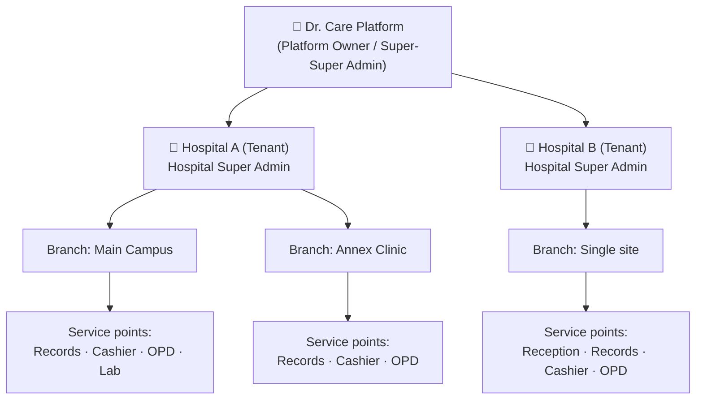
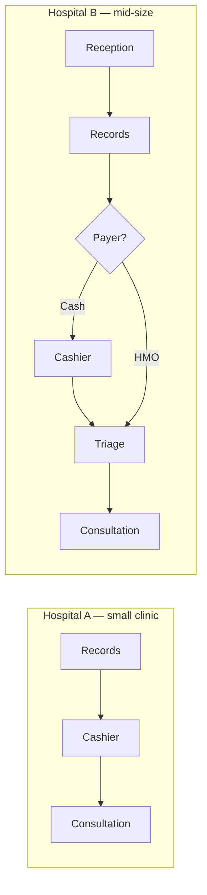
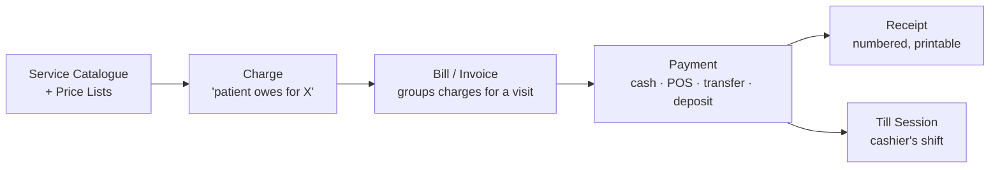
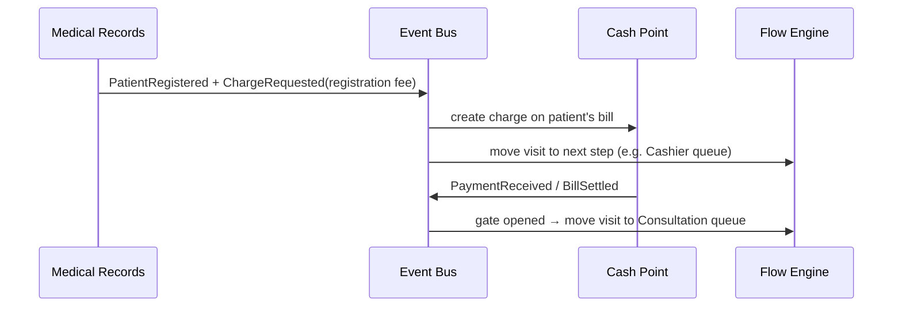
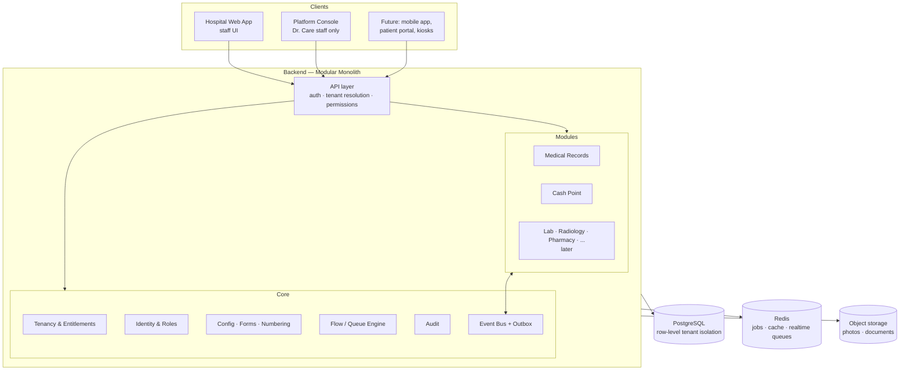

# Dr. Care HMIS — Foundation Architecture

> Status: draft blueprint · Scope of first build: **Medical Records (patient registration)** and **Cash Point**
> Audience: founders, product, engineering. Written for people who know how hospitals run, not necessarily how software is built.

---

## 1. The one-sentence idea

**Dr. Care is one core platform with plug-in modules. Every hospital gets the same engine, but each hospital switches modules on/off, shapes its own forms, numbering and patient journey, and runs its own administration — while Dr. Care watches over all hospitals from above.**

Three ideas make that possible. Everything else in this document is detail on these three:

| # | Idea | What it means in practice |
|---|------|---------------------------|
| 1 | **Layered tenancy** | Dr. Care → Hospital (tenant) → Branch (facility) → Service point. Each layer has its own admin and its own rights. |
| 2 | **Configuration over code** | Forms, patient-number format, prices, patient flow and payment rules are *data the admin edits*, not code we change per hospital. |
| 3 | **Modules that talk through events** | Medical Records, Cash Point, Lab, Radiology… are separate plug-ins. They never reach into each other; they announce things ("patient registered", "payment received") and others react. Remove a module and nothing else breaks. |

---

## 2. Who controls what (the authority layers)



### Layer 1 — Dr. Care Platform (us)
Lives in a **separate app: the Platform Console**. It is never mixed with the hospital app.

- Onboard a new hospital: create the tenant, its first branch, and its **Hospital Super Admin** account.
- **Entitlements**: decide which modules a hospital *may* use (based on their plan/contract). e.g. Hospital A: Records + Cash Point + Lab. Hospital B: Records + Cash Point only.
- Set hard limits: number of branches, users, storage.
- See across all hospitals: health, usage, billing, errors, version.
- **Support access** ("break-glass"): we can enter a hospital to help, but only through a logged, time-limited session that the hospital can see in its audit log. We do not browse patient data casually — that protects us legally and builds trust.

### Layer 2 — Hospital (tenant) Super Admin
Full control **inside** their hospital, within what Dr. Care has entitled. They don't need us for daily admin.

- Turn entitled modules on/off.
- Create branches, departments, service points.
- Create users, create roles, assign permissions.
- Configure forms, numbering, prices, payment rules, patient flow.

### Layer 3 — Branch / Facility
Big hospitals have several sites; small clinics have one. **We always model at least one branch**, even for a single clinic — so the day a clinic opens a second site, nothing has to be re-architected. Settings can be set hospital-wide and *overridden* per branch (e.g. different price list at the annex).

### Layer 4 — Service points & staff
Records desk, Cashier, OPD room 1, Triage, Lab reception… Staff are assigned to service points and see their queues.

> **Rule of inheritance:** Platform entitles → Hospital enables & configures → Branch overrides → Role permits → User acts.
> A user can only do something if *every* layer above says yes.

---

## 3. Plug-and-play: how a "module" works

Every feature area is a **module** with a manifest. The core platform reads the manifest; it never hard-codes knowledge of Lab, Pharmacy, etc.

```text
Module manifest (example: Cash Point)
─────────────────────────────────────
id:            cash-point
depends on:    core, patients
permissions:   billing.view, billing.charge, payment.receive,
               payment.refund, payment.void, till.open, till.close, ...
settings:      receipt number format, currencies, payment methods,
               refund approval required?, deposit allowed?, ...
service-point types it provides:  "Cashier"
events it publishes:   PaymentReceived, BillSettled, RefundIssued
events it listens to:  ChargeRequested (from any module)
UI it contributes:     menu items, dashboard widgets, patient-profile tab
```

What this buys us:

- **Switching off a module** hides its menus, revokes its permissions and stops its event listeners. Data is kept (never deleted), so switching back on restores everything.
- **Adding a new module later** (Lab, Radiology, Dialysis, Physio, Pharmacy, Inpatient, Insurance/HMO…) is adding a new manifest + code. The core and existing modules don't change.
- **Functions inside a module are pluggable too** — they're *settings* and *permissions* declared by the module. e.g. Cash Point → "allow deposits" on/off; Records → "capture next of kin" on/off.

### The four places flexibility lives

| Flexibility type | Example | Who configures |
|---|---|---|
| **Module on/off** | Hospital doesn't do radiology → module off | Platform entitles, Hospital admin enables |
| **Settings** | Refunds need approval: yes/no | Hospital admin (per branch override) |
| **Forms (fields)** | Add "State of origin", hide "Religion", make "Phone" required | Hospital admin |
| **Workflow (patient flow)** | Records → Cashier → Consultation *vs* Reception → Records → Triage → Consultation | Hospital admin |

---

## 4. Configurable patient flow (the "journey")

This is the part that makes every hospital feel the software was built for them.

### Concepts
- **Visit (Encounter)** — one trip to the hospital. Every visit has a status and a current location.
- **Service point** — a place where a patient waits and is attended to (Records, Reception, Cashier, Triage, OPD, Lab…). Each has a **queue**.
- **Flow template** — the ordered path a type of visit follows, defined by the admin. A hospital can have several: "New patient – cash", "Returning patient – HMO", "Emergency", "Antenatal".
- **Gates** — conditions on a step, e.g. *"cannot enter Consultation until the consultation bill is paid"* or *"HMO patients skip cashier"*.

### Example: two hospitals, same software



Nothing in the code says "Records comes before Cashier". The admin draws it. The engine just moves the visit from queue to queue and checks gates.

**Emergency rule:** every flow must allow *"treat first, pay later"* overrides with a reason captured and audited. A hospital system must never block care because of software.

---

## 5. First build — Module 1: Medical Records (Patient Registration)

### 5.1 Patient record = fixed core + configurable extras
- **Core fields** (always exist, the system depends on them): name parts, sex, date of birth (or estimated age), phone, patient number, registration date, branch.
- **Standard optional fields** (we provide, hospital toggles/marks required): address, next of kin, marital status, occupation, blood group, allergies, national ID, email, photo, religion, tribe/state of origin…
- **Custom fields** (hospital invents): any type — text, number, date, dropdown, yes/no. Stored safely alongside the record without needing a database change.

The **form layout** (sections, order, required/optional, help text) is a form definition the admin edits in a form builder. Different forms are possible per patient category (e.g. Adult, Child, Antenatal, Corporate staff).

### 5.2 Customizable patient registration number
Every hospital wants its own format. We give them a **template** with tokens:

| Token | Meaning | Example output |
|---|---|---|
| `{PREFIX}` | Fixed text | `DRC` |
| `{BR}` | Branch code | `LAG` |
| `{YYYY}` / `{YY}` | Year | `2026` / `26` |
| `{MM}` | Month | `10` |
| `{CAT}` | Patient category code | `ANC` |
| `{SEQ:n}` | Running number, zero-padded to n digits | `000123` |

Examples a hospital could set:
- `{PREFIX}/{SEQ:6}` → `DRC/000123`
- `{BR}-{YY}-{SEQ:5}` → `LAG-26-00123`
- `{SEQ:4}/{YY}` → `0123/26` (very common in older paper systems)

Plus the rules that hospitals actually care about:
- **Sequence scope** — one counter for the whole hospital, or one per branch, or one per category.
- **Reset** — never / yearly / monthly.
- **Starting number** — so a hospital migrating from paper can continue from `4,571`.
- **Legacy number** — store the old card number alongside the new one, searchable.
- **Guarantees** — numbers are generated by the server inside a transaction: **never duplicated, never reused**, even when two clerks register at the same second.

The same numbering engine is reused for receipt numbers, invoice numbers, visit numbers, lab numbers later.

### 5.3 Other Records essentials
- **Duplicate detection** before saving (same name + DOB + phone → "possible match, is this the same patient?").
- **Merge patients** (with full audit) — duplicates always happen in real life.
- **Search** by number, name, phone, legacy number.
- **Patient categories / payer** on the record: Cash, HMO/Insurance (with scheme + enrollee ID), Corporate, Staff, Family/retainership.
- **Patient card / label printing** with configurable layout.
- **Medical records are never hard-deleted.** Only deactivated, with reason and audit.

---

## 6. First build — Module 2: Cash Point (Billing & Payments)

### 6.1 The money model (simple words)



| Thing | What it is |
|---|---|
| **Service catalogue** | Everything the hospital sells: registration fee, card fee, consultation, later lab tests, drugs, scans. Each with a code. |
| **Price lists (tariffs)** | Prices per payer: Cash price, HMO-X price, Corporate-Y price, Staff price. Can differ per branch. Effective dates so price changes don't rewrite history. |
| **Charge** | A line saying "patient owes ₦X for service Y". Created by *any* module (Records creates "registration fee"; later Lab creates "FBC test"). Cash Point does not need to know about Lab. |
| **Bill** | Groups charges, usually per visit. Shows paid / outstanding. |
| **Payment** | Money received, with method and reference. One payment can settle several charges; one charge can be paid in parts (if allowed). |
| **Receipt** | Numbered using the same numbering engine; reprints marked "COPY". |
| **Till session (shift)** | Cashier opens till with float, receives payments, closes with a count; system shows expected vs counted → over/short report. |
| **Deposit / wallet** | Patient pays in advance; services draw from it. (toggle) |
| **Refund / void / discount / waiver** | Never edits the original; creates a new reversing record. Configurable approval (e.g. above ₦10,000 needs the accountant). |

### 6.2 Rules that make it trustworthy
- **Money records are append-only.** Mistakes are fixed by reversal entries, not edits/deletes. This is what auditors and hospital owners need to trust the system.
- Every amount stores **currency** and uses exact decimal arithmetic (no rounding drift).
- **Payment-before-service vs service-before-payment** is a *gate in the patient flow* (section 4), configured per service point and per payer — not hard-coded.
- **HMO/insurance patients**: charges go to the HMO bill instead of the cashier queue (full claims management is a later module; Cash Point already supports "who pays" per charge).
- Reports from day one: daily collections by cashier / method / service / branch, outstanding bills, refunds & discounts, till over/short.

### 6.3 How Records and Cash Point work together (without depending on each other)



If a hospital turns Cash Point **off** (e.g. a free NGO clinic), Records still publishes its events — nobody listens to the charge request, and the flow simply has no payment gate. Nothing breaks.

---

## 7. Security, roles & audit

- **Role-based access control (RBAC)**: modules declare permissions; hospital admins compose them into roles (Records Officer, Cashier, Head Cashier, Accountant, Doctor, Nurse…). We ship sensible default roles they can copy and edit.
- **Scoping**: a role can be limited to certain branches/service points (a cashier at the Annex can't take money at Main).
- **Audit log** on everything: who, what, when, where, before/after values. Append-only. Visible to the hospital admin; platform-level access to it is itself audited.
- **Sensitive actions** (refund, void, merge patients, price change, role change) can require a second approver — configurable.
- **Authentication**: strong passwords, optional 2FA, session timeout on shared front-desk computers, quick PIN switch for shared workstations.
- **Data protection**: patient data encrypted in transit and at rest; comply with local health-data and privacy law (e.g. NDPA in Nigeria) — legal review needed per country.

---

## 8. Technical architecture

### 8.1 Shape: a **modular monolith** first, not microservices
One backend application, internally split into strict modules (Core, Tenancy, Identity, Patients, Billing, Flow, and later Lab, etc.). Each module owns its own database tables and talks to others only through public interfaces and events.

Why: a small team ships faster, deploys once, and debugs one thing. Because module boundaries are strict from day one, any module can be split out into its own service later *if* scale demands it. This is the "strong architecture we can improve on tomorrow" without paying the microservices cost today.



### 8.2 Multi-tenancy in the database
- **Default: shared database, every row carries `tenant_id`**, enforced by PostgreSQL **Row-Level Security** so even a coding mistake can't leak Hospital A's patients to Hospital B.
- **Large hospital option**: the same code can point a tenant to its **own dedicated database** (for big hospitals, government contracts, or data-residency requirements). Design for this from day one by never writing cross-tenant queries in hospital code.
- Platform Console reads aggregated/anonymised metrics, not raw patient tables.

### 8.3 Suggested stack (reasonable defaults — open to change)
| Layer | Choice | Why |
|---|---|---|
| Frontend (this repo, `drcare-hmis-fe`) | **Next.js + TypeScript**, Tailwind + shadcn/ui, TanStack Query | Mature, fast to build data-heavy admin UIs; form builder and tables are well supported |
| Backend (separate repo `drcare-hmis-be`) | **NestJS (TypeScript)** — its module system maps 1:1 to our plug-in modules | One language across FE/BE; strong structure for a growing team |
| Database | **PostgreSQL** (JSONB for custom fields, RLS for tenancy) | Reliable, transactional (money + numbering need this) |
| Jobs / realtime | Redis + BullMQ; WebSockets for live queues | Queue screens update instantly |
| Files | S3-compatible storage | Photos, scanned documents |
| Hosting | Any cloud with a region close to customers; containers | Data residency matters for health data |

### 8.4 Built in from day one (cheap now, very expensive later)
1. `tenant_id` + `branch_id` on every business table.
2. Audit log + append-only money ledger.
3. Numbering engine as a shared service.
4. Event bus with **outbox** (events are saved in the same transaction as the data, so no event is ever lost).
5. Module manifest + entitlement check on every API call and every menu item.
6. Settings with inheritance (platform default → hospital → branch).
7. Soft-delete only for clinical/financial data.
8. Medical coding-friendly data model (ICD-10 for diagnoses, and a data shape that can export to **HL7 FHIR** later — needed for insurers, government reporting and interoperability).
9. **Unreliable internet**: small clinics lose connectivity. At minimum, the front desk should degrade gracefully (retry, queue requests, clear "offline" banner). A true offline mode for Records + Cash Point is a deliberate later phase — but we design IDs and numbering so it's possible.

---

## 9. Roadmap

| Phase | Deliverable | Done when… |
|---|---|---|
| **0 — Foundation** | Tenancy (hospital/branch), Platform Console basics, auth, roles & permissions, module registry & entitlements, settings, audit log, numbering engine, event bus | Dr. Care can onboard a hospital, create its super admin, and that admin can create users/roles and enable modules |
| **1 — Medical Records** | Form builder for registration, custom fields, patient number templates, search, duplicate detection, merge, patient categories/payers, card printing | Two very different hospitals can register patients with their own forms and numbers, with no code change |
| **2 — Cash Point** | Service catalogue, price lists per payer/branch, charges, bills, payments, receipts, till sessions, deposits, refunds/voids with approvals, collection reports | A cashier can run a full shift and reconcile it; the owner trusts the daily report |
| **3 — Patient Flow** | Service points, queues, flow templates, payment gates, queue display screens | Hospital A and Hospital B (section 4) run their different journeys on the same build |
| **Later** | Consultation/EMR, Nursing/Triage, Lab, Radiology, Pharmacy & Inventory, Inpatient/Wards, HMO claims, Specialist units (Dialysis, Physio…), Accounting, Patient portal, Offline mode, Analytics | Each added as a module, without touching the ones before |

> Note: a *minimal* version of the flow engine (Records → Cashier → "done") is needed in Phase 1–2 so that "pay before service" works; Phase 3 makes it fully configurable.

**Validation step before Phase 1 coding:** document the real journeys of 3 pilot hospitals (one small, one medium, one large). If the configuration model above can express all three without special code, the foundation is right.

---

## 10. Decisions still to make

1. **Countries & currencies at launch?** (affects tax, data residency, ID formats, privacy law)
2. **Offline mode** — how early? Must Records + Cash Point work with no internet for small clinics?
3. **Pricing model** — per module, per branch, per user? (Entitlements are designed to support any of these.)
4. **Hosting** — our cloud only, or also on-premise servers for large/government hospitals?
5. **Who configures new hospitals** — our implementation team, the hospital admin, or both (a guided setup wizard)?
6. **Backend repo & team** — confirm NestJS + PostgreSQL, or an existing preference.

---

## Glossary
- **Tenant** — one hospital/organisation using Dr. Care; its data is isolated from every other tenant.
- **Branch / Facility** — a physical site belonging to a tenant.
- **Service point** — a desk/room where patients queue (Records, Cashier, OPD…).
- **Module** — a pluggable feature area (Records, Cash Point, Lab…).
- **Entitlement** — permission from Dr. Care for a tenant to use a module.
- **Visit / Encounter** — one episode of a patient attending the hospital.
- **Charge / Bill / Payment / Receipt** — see section 6.
- **Event** — a message one module publishes when something happens, so other modules can react without being tied to it.
